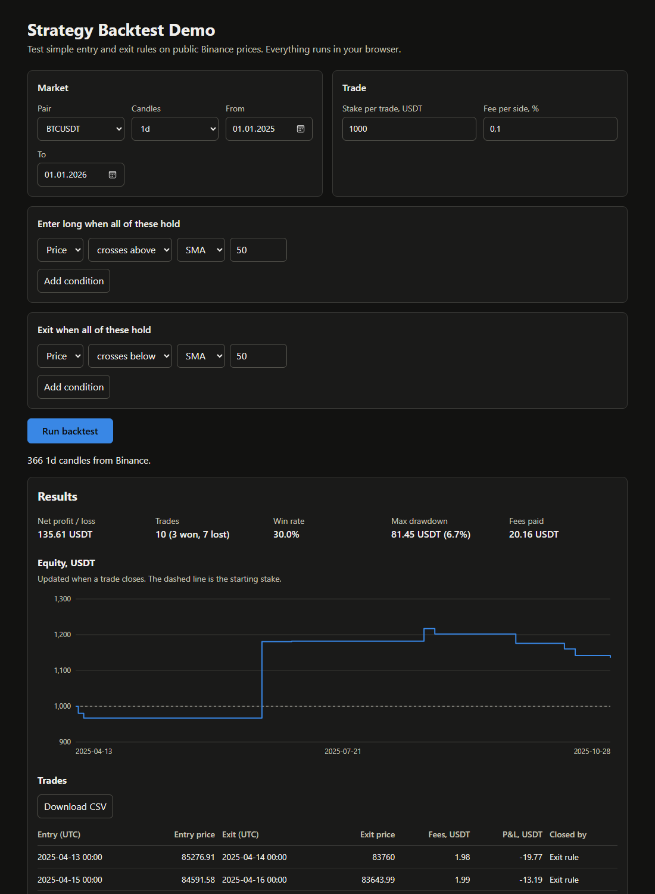

# Strategy Backtest Demo

Test simple trading rules on real Binance prices, right in the browser. No server, no sign-up, no API key.

**Live demo:** https://yeldos13.github.io/backtest-demo/

This is a demo project built for my portfolio, not client work and not financial advice.



## What it does

- Pick a pair (BTC, ETH, SOL or BNB against USDT), candle size (1h, 4h or 1d) and period.
- Set entry and exit rules of up to 3 conditions each, using price, SMA, EMA, RSI or a fixed value.
- Set the stake per trade and the fee.
- Get net profit or loss, win rate, max drawdown, an equity chart and a list of trades.
- Download the trades as CSV.

## How results are calculated

- Long only, one position at a time, with the same stake on every trade.
- A rule is read at a candle's close and the trade fills at the next candle's open, so it never uses a price that was not known yet.
- The fee is charged on both the entry and the exit.
- A position still open at the end of the period closes at the last close.
- Equity changes only when a trade closes, so drawdown inside an open trade is not counted.
- Slippage is not modelled.

## Data

Prices come from the public Binance market data API. If it can't be reached, the page uses daily candles saved in `data/snapshot.json` and says so on screen. This project is not affiliated with Binance.

To refresh the saved prices:

```bash
node scripts/make-snapshot.js
```

## Run locally

The page uses ES modules, so it needs a local web server rather than opening the file directly:

```bash
npx serve .
```

## Tests

The calculations are covered by tests using Node's built-in test runner (Node 22 or newer), with no dependencies to install:

```bash
npm test
```

## Code

| File | Purpose |
|---|---|
| `src/indicators.js` | SMA, EMA, RSI |
| `src/rules.js` | Entry and exit conditions |
| `src/engine.js` | Trade simulation |
| `src/report.js` | Metrics, equity curve, CSV |
| `src/data.js` | Binance prices and the saved fallback |
| `src/form.js` | Form input validation |
| `src/chart.js` | Equity chart in SVG |
| `src/app.js` | Page wiring |

## License

MIT
